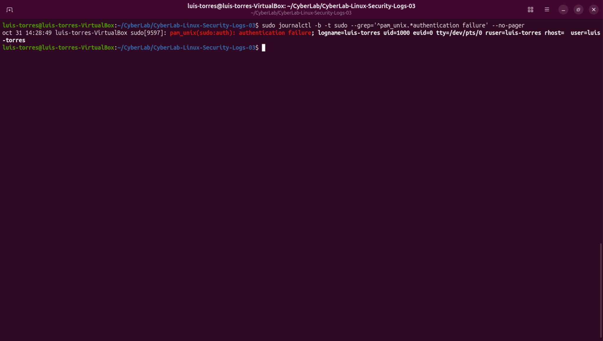
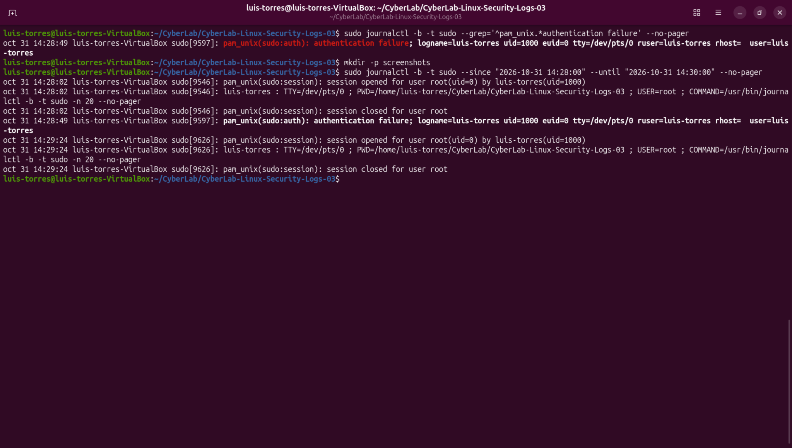

# CyberLab 03 — Linux Security Logs

## Objective
Investigate sudo activity using journalctl, identify a controlled authentication failure, and reconstruct the surrounding event timeline.

## Environment
- Ubuntu Desktop running in VirtualBox
- Log source: systemd journal
- Tools: journalctl, sudo, and regular expressions
- All timestamps below use the VM's local time.

## Procedure
1. Reviewed recent journal entries from the current boot.
2. Filtered records associated with sudo.
3. Generated one intentional authentication failure using an incorrect password.
4. Located the failure in the journal.
5. Refined the search to exclude command records containing the search phrase.
6. Reviewed a two-minute interval around the event.

## Findings
| Time | PID | Observation |
|---|---|---|
| 14:28:02 | 9546 | A privileged journal query ran and its session closed. |
| 14:28:49 | 9597 | PAM recorded a sudo authentication failure. |
| 14:29:24 | 9626 | Another privileged journal query ran and its session closed. |

The events involved the same username and terminal but different processes. The later command occurred 35 seconds after the failure.

The failed authentication was intentionally generated for this lab. The later privileged session does not establish that the failed attempt gained access.

## Filtering Lesson
A search for "authentication failure" also matched a sudo command record containing that phrase. Anchoring the pattern to the beginning of the PAM message excluded that unrelated match.

Final pattern: ^pam_unix.*authentication failure

## Evidence
- screenshots/Sudo_Authentication_Failure.png
- screenshots/Sudo_Event_Timeline.png

## Skills Practiced
- Linux journal analysis
- Authentication event investigation
- Regular expression filtering
- Timeline reconstruction
- Evidence-based interpretation

## Screenshots

### Sudo Authentication Failure

The following screenshot shows a controlled sudo authentication failure identified through Linux system logs.

### Sudo Event Timeline

The following screenshot demonstrates the reconstruction of sudo authentication events using journalctl.

